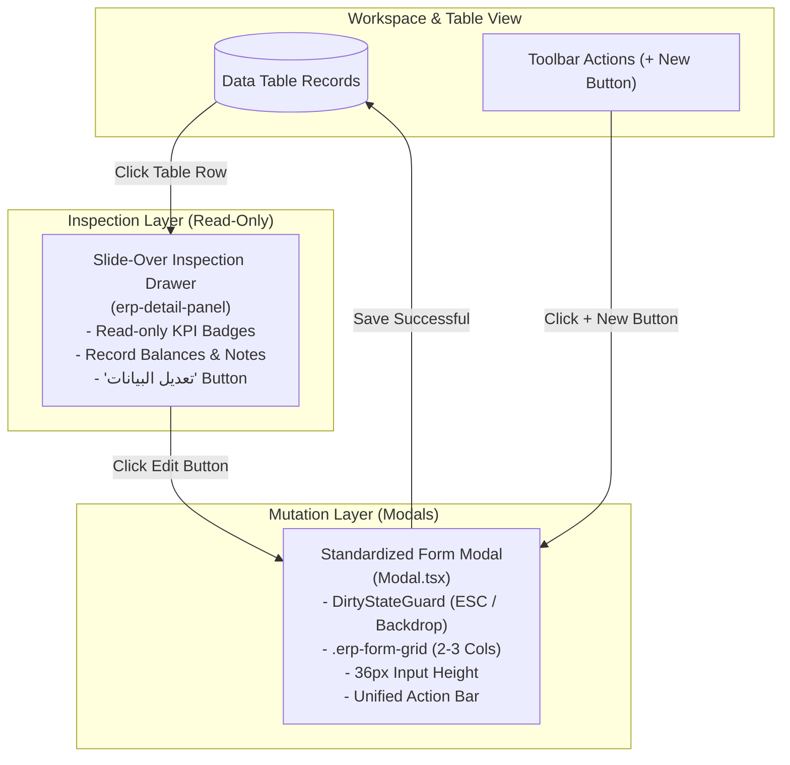

# MaksabPlus Unified Form Grid & Modal System

* **Author:** Abdulrahman Eid
* **Status:** Draft
* **Date:** 2026-11-05

--------------------------------------------------------------------------------

## Overview

MaksabPlus is a multi-tenant SaaS ERP designed for small business owners and retail cashiers in Arabic (Egyptian, RTL). This design establishes a cohesive visual identity, spatial rhythm, and interaction model across all forms and dialogs in the application.

Rather than executing an arbitrary aesthetic redesign, this initiative anchors on the established spatial layout of the sales invoice form (`InvoiceForm`) as the golden standard. It standardizes all input controls to a uniform 36px height, introduces a shared responsive form grid (`.erp-form-grid`), standardizes all Create and Edit workflows inside focused modal dialogs, and restricts slide-over side panels (`erp-detail-panel`) strictly to read-only record inspection.

## The Problem

1. **Spatial & Visual Inconsistency**: While `InvoiceForm` features balanced grouping and clear visual hierarchy, secondary transaction forms (e.g., `CashBoxTransferForm`) and entity entry forms (e.g., adding customers or suppliers) suffer from extreme spatial imbalance. Single fields such as transaction dates stretch across entire rows, wasting vertical space and producing an unpolished, fragmented experience.
2. **Modal vs. Side Drawer Ambiguity**: The system currently mixes paradigms: financial documents use modals, while Master Data tables mix in-drawer inspection with layered modal triggers. This causes visual crowding and inconsistent field placement when editing entity records.
3. **Accidental Dismissal & Data Loss**: Existing modal dialogs (`Modal.tsx`) close immediately upon pressing the `Escape` key or clicking the dark backdrop. In high-speed retail environments, accidental dismissal causes catastrophic loss of uncommitted line items and typed customer details.
4. **CSS Duplication & Fragmentation**: Page-specific stylesheets (e.g. `invoice-form.css` at 1,632 lines) contain duplicated definitions for inputs, labels, and action buttons, creating maintenance overhead and CSS specificity conflicts.

## Goals

* **Standardized 36px Control Height**: All interactive inputs (`<input>`, `<select>`, `SearchableSelect`, `DateInput`) adopt a uniform 36px height, 7px border radius, and consistent typographic baseline across all dialogs and workspace toolbars.
* **Shared Responsive Form Grid (`.erp-form-grid`)**: Implement a reusable 12-column grid primitive supporting balanced 2-column (`.erp-col-6`) and 3-column (`.erp-col-4`) field groupings, reserving full width (`.erp-col-12`) strictly for multiline text areas (notes, descriptions).
* **Unified Entity Modals**: Migrate all create and edit workflows in Master Data (Customers, Suppliers, Items, Warehouses, Cash Boxes) into standardized modals with identical action button placement (Primary Save on the right, Outline Cancel on the left in RTL).
* **Purified Inspection Drawers**: Restrict slide-over side panels (`erp-detail-panel`) exclusively to read-only row inspection on table click, delegating edit actions cleanly to the entity modal.
* **Dirty State Guard**: Implement an uncommitted change guard in `Modal.tsx` that blocks accidental dismissal via `Escape` key or backdrop clicks whenever form fields contain unsaved modifications.
* **Sibling Document Parity**: Align `ReceiptForm`, `WarehouseTransferForm`, and `CashBoxTransferForm` to the 36px standard and action button sequence without altering accounting logic.

## Non-Goals

* **No Backend or Database Alterations**: Zero changes to PostgreSQL tables, RLS policies, migrations, Supabase RPC signatures, or double-entry ledger calculations.
* **No Redesign of the Invoice Line Engine**: The barcode scanning mechanism, real-time stock computation, and item table grid in `InvoiceItemsTable.tsx` remain functionally identical.
* **No Workflow Complexity Expansion**: Zero new screens, tabs, menu items, or accounting jargon introduced into the cashier's daily path.
* **No External UI Library Dependencies**: Retain pure Vanilla CSS design tokens; no installation of Tailwind CSS, Bootstrap, or third-party UI component libraries.

## Open Questions

* **Question 1**: Should touch targets on point-of-sale touch screens enforce a minimum 44px hit-box via outer touch padding (`margin` / touch target wrapper) while visually preserving the 36px control height?

## Critical User Journeys (CUJs)

### CUJ 1: Creating a Customer or Supplier from Master Data
* **Given**: An authenticated user with `data.customers.create` permission is viewing the Customers tab.
* **When**: The user clicks the "+ إضافة عميل" action button.
* **Then**: A standardized entity modal opens with automatic focus on the "الاسم" field. Inputs (Name, Phone, Balance, Type) render in a balanced 2-column grid, with Notes spanning full width. Action buttons appear at the bottom with Save on the right and Cancel on the left.

### CUJ 2: Quick Record Inspection in Master Data Table
* **Given**: A merchant is browsing a list of inventory items or customer accounts in the workspace table.
* **When**: The user clicks any row in the table.
* **Then**: The slide-over inspection drawer (`erp-detail-panel`) opens smoothly on the left/end side displaying read-only summary badges and balances, without covering the table or rendering editable input controls. Clicking "تعديل البيانات" opens the dedicated modal.

### CUJ 3: Accidental Dismissal Protection During Data Entry
* **Given**: A cashier is entering a multi-line invoice or filling in customer contact details inside a modal.
* **When**: The cashier inadvertently presses `Escape` or clicks the backdrop overlay outside the modal dialog.
* **Then**: The modal intercepts the event, keeps the dialog open, and displays a confirmation prompt (`ConfirmDialog`) before discarding any uncommitted changes.

--------------------------------------------------------------------------------

## Technical Plan (Architecture)

### 1. Component & Interaction Architecture

The target architecture establishes a clean separation between **Data Inspection** and **Data Mutation**:



### 2. Design Token & Grid Foundation Layer

#### Token Normalization (`src/styles/tokens.css`)
Establish standardized design tokens matching the golden standard:
```css
:root {
  /* Control Dimensions */
  --erp-control-height: 36px;
  --erp-control-height-compact: 32px;
  --erp-control-radius: 7px;
  --erp-control-font-size: 13px;

  /* Spacing Grid */
  --erp-grid-gap-row: 12px;
  --erp-grid-gap-col: 14px;
}
```

#### Shared CSS Grid Primitive (`src/styles/components/forms.css`)
Introduce a 12-column responsive layout container that prevents single fields from monopolizing full rows:
```css
.erp-form-grid {
  display: grid;
  grid-template-columns: repeat(12, minmax(0, 1fr));
  gap: var(--erp-grid-gap-row, 12px) var(--erp-grid-gap-col, 14px);
  width: 100%;
}

.erp-col-4 { grid-column: span 4; } /* 3-column items */
.erp-col-6 { grid-column: span 6; } /* 2-column items */
.erp-col-12,
.erp-col-full { grid-column: span 12; } /* Full-width items (notes, multiline) */

@media (max-width: 768px) {
  .erp-col-4,
  .erp-col-6 {
    grid-column: span 12; /* Automatic single-column collapse on small mobile screens */
  }
}
```

### 3. Modal Architecture & Accidental Dismissal Guard (`src/components/Modal.tsx`)

Enhance `Modal.tsx` with dirty-state interception:
* **Interface Addition**:
  ```typescript
  interface ModalProps {
    title: ReactNode;
    children: ReactNode;
    onClose: () => void;
    isDirty?: boolean;           // Indicates uncommitted user input
    confirmOnDismiss?: boolean;  // Intercepts ESC and backdrop clicks when dirty
    className?: string;
    backdropClassName?: string;
  }
  ```
* **Dismissal Interception Flow**:
  1. User presses `Escape` or clicks `.modal-backdrop`.
  2. If `isDirty && confirmOnDismiss`, the modal triggers an internal confirmation dialog or prompts the parent handler rather than executing `onClose()` immediately.
  3. If user confirms abandonment, `onClose()` executes. Otherwise, the modal remains mounted with full state intact.

### 4. Action Button Bar Standardization (`.form-modal-actions`)

Unify action button ordering across all forms in RTL reading order:
* **Primary Action (Save / Submit)**: Positioned on the natural starting side (right in RTL), styled with `.btn.primary`, holding `<Save size={15} />`. Disabled with `disabled={busy}` and label "جارٍ الحفظ…" during network RPC calls.
* **Secondary Action (Cancel / Close)**: Positioned on the trailing side (left in RTL), styled with `.btn.outline` or neutral styling, holding `<X size={15} />`.
* **Destructive Actions (Delete / Permanent Erase)**: Removed completely from create/edit forms. Destructive operations are triggered strictly from table row action menus or read-only detail panels, and always require explicit `ConfirmDialog` confirmation naming the record.

### 5. Sibling Transaction Forms Alignment

Apply the 36px standard and `.erp-form-grid` to sibling documents:
* **`CashBoxTransferForm.tsx`**:
  - Row 1 (3-column): Source Cash Box (`.erp-col-4`), Destination Cash Box (`.erp-col-4`), Transfer Date (`.erp-col-4`).
  - Row 2 (2-column): Transfer Amount (`.erp-col-6`), Arabic Currency Tafqeet (`.erp-col-6`).
  - Row 3 (Full-width): Statement / Notes (`.erp-col-12`).
  - Row 4: Unified `.form-modal-actions` bar.
* **`ReceiptForm.tsx` & `WarehouseTransferForm.tsx`**:
  - Harmonize container padding, label typography, and input heights to exactly match the 36px control height.

### 6. Master Data Entity Forms & Drawer Purification

* **Purify `erp-detail-panel`**:
  - In `AccountsTab.tsx`, `ItemsTab.tsx`, `WarehousesTab.tsx`, `CashBoxesTab.tsx`, remove all inline `<input>` and `<form>` markup from the slide-over drawer.
  - The drawer displays `<dl className="erp-detail-summary">`, entity status badges (`StatusBadge`), balance preview chips (`AccountBalancePills`), and a single "تعديل البيانات" action button that delegates to the entity modal.
* **Migrate Add/Edit Modals**:
  - Wrap create/edit inputs in `.erp-form-grid`.
  - Customer/Supplier: Name (`.erp-col-6`), Phone (`.erp-col-6`), Opening Balance (`.erp-col-6`), Balance Type (`.erp-col-6`), Notes (`.erp-col-12`).
  - Item: Name (`.erp-col-6`), Barcode (`.erp-col-6`), Unit (`.erp-col-4`), Sale Price (`.erp-col-4`), Purchase Price (`.erp-col-4`), Notes (`.erp-col-12`).

--------------------------------------------------------------------------------

## Alternatives Considered

### Alternative A: Universal Form Engine Component
* **Description**: Building a centralized dynamic form generator component driven by declarative JSON field configurations for all forms across the product.
* **Pros**: Single point of code definition; high theoretical DRY metrics.
* **Cons**: Introduces heavy abstraction; makes custom keyboard navigation, barcode scanner autofocus refs, and live stock calculation extremely brittle; tightly couples simple entity cards with complex master-detail transactions.
* **Reason for Rejection**: Rejected by author. Violates the complexity budget and architectural boundaries of `AGENTS.md`. Shared CSS grid primitives (`.erp-form-grid`) and shared UI primitives (`SearchableSelect`, `DateInput`) achieve visual and structural uniformity without runtime coupling.

### Alternative B: In-Drawer Form Editing for Master Data
* **Description**: Embedding editable form fields directly inside the 520px slide-over inspection drawer (`erp-detail-panel`) instead of opening a modal.
* **Pros**: Keeps user interaction within a single viewport element without layering.
* **Cons**: 520px width causes severe vertical field stretching and visual crowding; inconsistent with transaction forms; creates cramped layout for multi-field entities.
* **Reason for Rejection**: Rejected by author. Negative user ergonomics when editing multiple fields in a narrow vertical drawer.

### Alternative C: Replacing Side Drawers Completely with Modals
* **Description**: Removing `erp-detail-panel` entirely and opening a modal dialog on every table row click.
* **Pros**: One single interaction pattern (Modal) across every screen in the system.
* **Cons**: Severely degrades rapid row-by-row browsing; inspecting records requires glanceable side-by-side verification without covering the table.
* **Reason for Rejection**: Rejected by author. Destroys fast inspection ergonomics for merchants browsing customer ledgers and inventory catalogs.

--------------------------------------------------------------------------------

## Non-Functional Requirements

### Performance & Latency
* **Zero Additional Network Latency**: Modals reuse local state from `MasterDataContext` and pass loaded entities to avoid extra roundtrips on open.
* **Minimal Browser Reflow**: Pure CSS Grid (`.erp-form-grid`) with explicit row/column spans ensures browser layout engines calculate geometry in a single layout pass.

### Accessibility & Keyboard Ergonomics
* **Strict Tab Sequencing**: Form fields follow natural RTL tab ordering (top-to-bottom, right-to-left).
* **Autofocus on Mount**: Every modal automatically autofocuses the primary input on mount (`autoFocus`).
* **Input Content Auto-Select**: Numeric and quantity inputs select all content on focus (`onFocus={(e) => e.target.select()}`), eliminating manual backspacing.
* **RTL & Number Isolation**: All currency, numeric, and date values reside inside `<bdi>` or `dir="ltr"` wrappers with `tabular-nums`.

### Rollout Safety
* **Zero Database Migration Dependency**: UI changes are decoupled from the database schema; zero risk of data drift, locking, or migration rollbacks.

--------------------------------------------------------------------------------

## Detailed Implementation Plan

The implementation is structured into four sequential phases to guarantee zero regression and verify sibling parity at each step:

### Phase 1: Tokens, Grid Utilities & Modal Safety Guard

#### 1. `src/styles/tokens.css` (Modify)
* **Scope**: Core CSS design tokens.
* **Proposed Changes**: Introduce normalized control height (`--erp-control-height: 36px`), compact height (`32px`), control radius (`7px`), and grid gap tokens (`12px` row gap, `14px` column gap).
* **Rationale**: Anchors all downstream layout calculations to a single source of truth.

#### 2. `src/styles/components/forms.css` (Modify)
* **Scope**: Component form styles.
* **Proposed Changes**: Implement `.erp-form-grid`, `.erp-col-4`, `.erp-col-6`, `.erp-col-12`, and `.form-modal-actions` utility classes. Adjust default `<input>`, `<select>`, and `textarea` heights to bind to `var(--erp-control-height)`.
* **Rationale**: Replaces fragile, ad-hoc inline styles with a reusable 12-column responsive grid system.

#### 3. `src/styles/components/modals.css` (Modify)
* **Scope**: Modal presentation layer.
* **Proposed Changes**: Ensure modal containers, headers, and footer action bars use unified margins, responsive maximum widths, and standard padding.
* **Rationale**: Provides consistent visual framing for all modal dialogs.

#### 4. `src/components/Modal.tsx` (Modify)
* **Scope**: Core modal dialog component.
* **Proposed Changes**: Add `isDirty?: boolean` and `confirmOnDismiss?: boolean` prop interfaces. Intercept `Escape` key events and backdrop clicks when `isDirty` is true, displaying a confirmation prompt before executing dismissal.
* **Rationale**: Prevents accidental data loss when cashiers or merchants mistakenly press `Escape` or click outside an in-progress form.

### Phase 2: Master Data Entity Modals & Drawer Purification

#### 5. `src/pages/master-data/AccountsTab.tsx` (Modify)
* **Scope**: Customer and supplier accounts management tab.
* **Proposed Changes**: Refactor the Add/Edit form from `.stack` into `.erp-form-grid` (Name: `.erp-col-6`, Phone: `.erp-col-6`, Opening Balance: `.erp-col-6`, Balance Type: `.erp-col-6`, Notes: `.erp-col-12`) inside `Modal`. Remove all form input elements from the slide-over `erp-detail-panel`, leaving it purely for read-only inspection with a "تعديل البيانات" trigger.
* **Rationale**: Eliminates cramped drawer editing and establishes clean 2-column entity creation.

#### 6. `src/pages/master-data/ItemsTab.tsx` (Modify)
* **Scope**: Product catalog management tab.
* **Proposed Changes**: Refactor Item Add/Edit modal into `.erp-form-grid` (Name: `.erp-col-6`, Barcode: `.erp-col-6`, Unit: `.erp-col-4`, Sale Price: `.erp-col-4`, Purchase Price: `.erp-col-4`, Notes: `.erp-col-12`). Purify the side inspection drawer to be read-only.
* **Rationale**: Unifies product form layout and prevents oversized single-row price inputs.

#### 7. `src/pages/master-data/WarehousesTab.tsx` (Modify)
* **Scope**: Warehouse management tab.
* **Proposed Changes**: Refactor Warehouse Add/Edit modal into `.erp-form-grid` (Name: `.erp-col-6`, Notes: `.erp-col-12`). Remove inline inputs from the side drawer.
* **Rationale**: Aligns warehouse management dialogs with the global entity modal standard.

#### 8. `src/pages/master-data/CashBoxesTab.tsx` (Modify)
* **Scope**: Cash box management tab.
* **Proposed Changes**: Refactor Cash Box Add/Edit modal into `.erp-form-grid` (Name: `.erp-col-6`, Notes: `.erp-col-12`). Remove inline inputs from the side drawer.
* **Rationale**: Aligns cash box management dialogs with the global entity modal standard.

#### 9. `src/styles/pages/erp-workspace.css` (Modify)
* **Scope**: Workspace layout stylesheet.
* **Proposed Changes**: Cleanse `.erp-detail-panel` styling of form input overrides, preserving strictly the summary badge, data list (`<dl>`), notes block, and action button styles.
* **Rationale**: Strips dead CSS declarations and enforces the pure inspection drawer contract.

### Phase 3: Sibling Transaction Forms Parity

#### 10. `src/components/CashBoxTransferForm.tsx` (Modify)
* **Scope**: Cash treasury transfer document form.
* **Proposed Changes**: Restructure from single-column vertical layout into `.erp-form-grid`:
  - Row 1: Source Cash Box (`.erp-col-4`), Destination Cash Box (`.erp-col-4`), Transfer Date (`.erp-col-4`).
  - Row 2: Transfer Amount (`.erp-col-6`), Arabic Currency Tafqeet (`.erp-col-6`).
  - Row 3: Notes (`.erp-col-12`).
  - Row 4: Standardized `.form-modal-actions` bar.
* **Rationale**: Resolves the extreme spatial imbalance where the date field previously consumed an entire row alone.

#### 11. `src/components/ReceiptForm.tsx` (Modify)
* **Scope**: Cash receipt voucher form (inflow/outflow).
* **Proposed Changes**: Refactor header inputs (Account Type, Account, Cash Box, Date) and amount/tafqeet inputs into `.erp-form-grid`, standardizing heights at 36px and unifying action button alignment.
* **Rationale**: Achieves sibling parity with `InvoiceForm` and `CashBoxTransferForm`.

#### 12. `src/components/WarehouseTransferForm.tsx` (Modify)
* **Scope**: Warehouse stock transfer form.
* **Proposed Changes**: Align source warehouse, destination warehouse, and date selectors into `.erp-form-grid` (3 columns), standardizing heights at 36px and unifying action button alignment.
* **Rationale**: Achieves sibling parity with `InvoiceForm`.

### Phase 4: Contract Documentation Updates

#### 13. `src/components/README.md` (Modify)
* **Scope**: Shared components contract documentation.
* **Proposed Changes**: Document `isDirty` and `confirmOnDismiss` props on `Modal.tsx`, as well as the `.erp-form-grid` standard.
* **Rationale**: Keeps component contracts accurately aligned with codebase capabilities.

#### 14. `src/pages/master-data/README.md` (Modify)
* **Scope**: Master data catalog contract documentation.
* **Proposed Changes**: Document the strict separation between read-only drawer inspection and modal mutation.
* **Rationale**: Maintains architectural documentation integrity.

--------------------------------------------------------------------------------

## Verification Plan

### Automated Verification Gates
Every gate must pass cleanly without suppression or regressions:
1. `npx tsc --noEmit`: 0 TypeScript compilation errors.
2. `npx eslint src`: 0 lint errors, 0 new warnings.
3. `npx vitest run`: All test suites (including `InvoiceForm.test.tsx`, `ReceiptForm.test.tsx`, `WarehouseTransferForm.test.tsx`, `ChangePasswordModal.test.tsx`) pass 100%.
4. `npx vite build`: Production bundle compiles cleanly without asset or chunk resolution issues.

### Manual Visual & Ergonomic Verification
* **RTL Layout Symmetry**: Inspect all modified modals in Arabic RTL at 1280px and 1920px viewports. Confirm primary save actions sit on the right and cancel buttons sit on the left.
* **Accidental Dismissal Test**: Open each modified modal, type arbitrary characters, and press `Escape` or click the backdrop. Verify the modal does NOT close and instead presents a confirmation dialog.
* **Tab Order & Autofocus**: Confirm that opening any modal immediately focuses the first input field, and pressing `Tab` navigates through fields in natural RTL logical order.
* **Screenshots Requirement**: Capture RTL screenshots of each modified screen at 1280px and 1920px and save them under `docs/screenshots/`.

--------------------------------------------------------------------------------

*Drafted with EGM*
