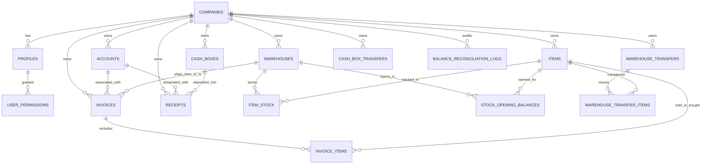

# 2. خريطة قاعدة البيانات (Database Architecture & Schema)

قاعدة بيانات مكسب بلس مبنية بالكامل على **PostgreSQL** عبر منصة **Supabase**. جميع جداول الأعمال تتبع مبدأ العزل الصارم للمستأجرين (`company_id`) وتستخدم دقة `numeric(18,4)` للأموال والكميات، وتوقيت القاهرة (`Africa/Cairo`) عبر دالة `cairo_today()`.

---

## المخطط الهيكلي للجداول الرئيسية (Entity-Relationship)

---

## الجداول الأساسية (Core Tables)

### 1. الكيانات والشركات والهوية (Tenants & Identity)
- `companies`: بيانات الشركة الأساسية (`name`, `currency`, `created_at`, `updated_at`).
- `profiles`: ملفات المستخدمين المرتبطة بـ `auth.users`؛ تحتوي على `company_id`, `full_name`, `access_role` (`'owner'` أو `'employee'`)، وحالة النشاط `is_active`.
- `user_permissions`: مصفوفة الصلاحيات التفصيلية لكل موظف (`user_id`, `company_id`, `permission_key`).

### 2. البيانات الرئيسية والترقيم (Master Data & Sequences)
- `accounts`: العملاء والموردون وحسابات النظام الثابتة.
  - `kind`: `'customer'` أو `'supplier'` أو `'waste'` (للهالك).
  - `system_key`: معرف الحسابات الثابتة (مثل `'cash_customer'`, `'cash_supplier'`, `'waste'`)، ويكون `NULL` للعملاء والموردين العاديين.
  - `serial_number`: رقم تسلسلي تلقائي لكل نوع (`CUS-00001` للعملاء، `SUP-00001` للموردين).
  - `opening_balance`, `effective_opening_balance`: الرصيد الافتتاحي والتسويات الافتتاحية المطبقة.
  - `current_balance`: الرصيد الحالي التراكمي (محدث لحظياً عبر Triggers).
  - `invoiced_total`, `paid_total`, `has_documents`: إجماليات مساعدة ومؤشر وجود مستندات نشطة.
- `items`: الأصناف والمنتجات.
  - `code`: كود الصنف / الباركود (إلزامي وفريد ضمن الشركة للأصناف النشطة أو بحسب القيود).
  - `serial_number`: التسلسلي الآلي (`ITM-00001`).
  - `unit`: وحدة القياس الافتراضية (`'قطعة'` افتراضياً).
  - `sale_price` و `purchase_price`: الأسعار الافتراضية (سعر الشراء محمي في العروض لغير المخولين).
- `warehouses`: المخازن (`is_primary` يحدد المخزن الرئيسي، تسلسلي `WH-00001`، `is_active`, `notes`).
- `item_stock`: جدول الربط لرصيد ومتوسط تكلفة الصنف في كل مخزن على حدة (`qty`, `avg_cost` بمتوسط التكلفة المتحرك).
- `cash_boxes`: الخزن النقدية (`is_primary` يحدد الخزنة الافتراضية، تسلسلي `CBX-00001`، `opening_balance`, `effective_opening_balance`, `current_balance`, `notes`, `is_active`).
- `document_sequences` و `entity_number_sequences`: عدادات الترقيم التسلسلي المستقل لكل شركة ولكل نوع مستند أو كيان.

### 3. الأرصدة الافتتاحية وتسوياتها (Opening Balances & Adjustments)
- `opening_balance_adjustments`: سجل تسويات الرصيد الافتتاحي للحسابات والخزن (`account_id` أو `cash_box_id`, `amount_delta`, `note`).
- `stock_opening_balances`: أرصدة أول المدة للصنف داخل المخزن (`opening_qty`, `unit_cost`).
- `stock_opening_adjustments`: سجل تسويات كميات وتكلفة أول المدة للمخزون (`quantity_delta`, `unit_cost`, `note`).

### 4. حركة المستندات التجارية (Invoices & Line Items)
- `invoices`: فواتير البضاعة وتتضمن 5 أنواع (`kind`):
  - `sale`: فاتورة بيع (`SAL-`).
  - `purchase`: فاتورة شراء (`PUR-`).
  - `sale_return`: مرتجع بيع (`SRT-`).
  - `purchase_return`: مرتجع شراء (`PRT-`).
  - `waste`: إتلاف / هالك مخزني (`WST-`).
  - الحقول المالية والرقابية: `subtotal`, `total`, `paid`, `cost_total`, `profit_total`, `invoice_date` (افتراضياً `cairo_today()`), `created_by_name`, `deleted_at` (للحذف اللطيف). يُحسب المتبقي (`remaining = total - paid`) في العروض دون تخزينه كعمود مستقل.
- `invoice_items`: بنود الفاتورة (`item_id`, `qty`, `unit_price`, `unit_cost`, `line_total` كعمود مولّد `round(qty * unit_price, 2)`).

### 5. حركات النقدية والتحويلات (Cash & Transfers)
- `receipts`: سندات القبض والصرف.
  - `direction`: `'in'` (إيصال استلام `RCP-`) أو `'out'` (إيصال صرف `PAY-`).
  - `invoice_id`: مرجع الفاتورة للإيصالات المرتبطة، أو `NULL` للإيصالات الحرة (`is_free` يُشتق في العرض `v_receipt_list`).
  - `amount`, `description`, `receipt_date` (افتراضياً `cairo_today()`), `created_by_name`, `deleted_at`.
- `warehouse_transfers`: إذن تحويل مخزني بين مخزنين (`WTR-`، `source_warehouse_id` إلى `destination_warehouse_id`, `transfer_date`, `created_by_name`, `deleted_at`).
- `warehouse_transfer_items`: أصناف وكميات وتكلفة التحويل المخزني (`item_id`, `qty`, `unit_cost`).
- `cash_box_transfers`: تحويل نقدية بين خزنتين (`CTR-`، `source_cash_box_id` إلى `destination_cash_box_id`, `amount`, `transfer_date`, `created_by_name`, `deleted_at`).

### 6. الرقابة والمطابقة (Audit & Reconciliations)
- `balance_reconciliation_logs`: سجل تدقيق append-only لعمليات الفحص والمطابقة الشاملة للحسابات والخزن والمخزون (`mode` إما `'reconcile'` أو `'simulation'`, `status`, `discrepancies_count`, `discrepancies`, `performed_by`, `performed_by_name`). القراءة مقتصرة على المالك.

---

## العروض والواجهات البرمجية لقاعدة البيانات (Views & RPCs)

### العروض (Views) — تعمل جميعها بـ `security_invoker = true`
- `v_invoice_list` و `v_invoice_items`: عرض الفواتير وبنودها مع حجب `cost_total`, `profit_total`, `unit_cost` لغير المخولين بـ `can_view_profit()`.
- `v_receipt_list`: عرض سندات القبض والصرف الحرة والمرتبطة مع أسماء الحسابات والخزن والمنشئ.
- `v_warehouse_transfer_list` و `v_warehouse_transfer_items`: عرض التحويلات المخزنية وبنودها مع حجب التكلفة لغير المخولين.
- `v_cash_box_transfer_list`: عرض تحويلات الخزن.
- `v_account_balances` و `v_cash_box_balances`: عروض أرصدة العملاء والموردين والخزن.
- `v_item_stock`, `v_warehouse_items`, `v_stock_opening_balances`: عروض المخزون وافتتاحيات المخزون، مع حجب التكاليف عبر `can_view_profit()` وحجب `purchase_price` عبر `read_protected_purchase_price()` و`can_view_purchase_price()`. وتفحص `v_stock_opening_balances.cost_locked` المستندات والتحويلات غير المحذوفة فقط (`0083`).

### دوال التصفح والـ KPI وفلاتر الأعمدة (Pagination, Column Filters & KPIs)
- `get_invoice_page` و `get_document_page`: جلب صفحات الفواتير، الإيصالات، والتحويلات بالخادم مع الفلاتر النصية وفلاتر الأعمدة المتحققة عبر `validate_list_columns` و `list_column_schema`.
- `filter_*_rows`: دوال تصفية مرقمة لكل نطاق (`filter_invoice_rows`, `filter_receipt_rows`, `filter_warehouse_transfer_rows`, `filter_cash_transfer_rows`, `filter_account_balance_rows`, `filter_master_account_rows`, `filter_master_item_rows`, `filter_warehouse_item_rows`, `filter_reconciliation_rows`).
- `get_*_kpis_columns`: دوال مؤشرات الأداء المجمعة على السيرفر مع فلاتر الأعمدة (`get_invoice_kpis_columns`, `get_receipt_kpis_columns`, `get_warehouse_transfer_kpis_columns`, `get_cash_box_transfer_kpis_columns`, `get_account_balances_kpis_columns`, `get_master_accounts_kpis_columns`, `get_master_items_kpis_columns`, `get_warehouse_stock_kpis_columns`, `get_reconciliation_log_kpis_columns`).
- `get_home_dashboard_summary` و `get_home_dashboard_charts`: بيانات لوحة التحكم الرئيسية والرسوم البيانية (بفترات `7, 14, 30, 60, 90, 180, 365, 0` يوماً) وكبار العملاء والأصناف الأكثر مبيعاً، مع استبعاد المستندات المستقبلية من مؤشرات اليوم الحالي.
- `get_account_statement`, `get_cash_box_statement`, `get_item_movement_statement`: استخراج كشوف الحساب وحركات الخزن والأصناف بالرصيد التراكمي المتحرك، مع فحص الصلاحية الفرعية لكل كشف.
- `save_account_opening_balances` و `save_opening_balances`: حفظ افتتاحيات الحسابات والخزن والمخزون في معاملات ذرية واحدة.
- `run_comprehensive_reconciliation`, `reconcile_all_balances`, `reconcile_item_stock`: محرك المطابقة الشاملة وتسوية الأرصدة والمخزون.

---

## ملخص الهجرات (Migrations 0001 - 0085)

1. **0001 - 0003**: تأسيس الجداول (`companies`, `profiles`, `accounts`, `items`, `warehouses`, `item_stock`, `cash_boxes`, `invoices`, `invoice_items`, `receipts`)، دالة `current_company_id()`، وسياسات RLS، ودوال الإنشاء الأولى.
2. **0004 - 0013**: إضافة الإيصالات الحرة، قيود التعديل، الحذف المرن (Soft Delete)، فواتير المرتجع (Returns)، والحسابات الثابتة.
3. **0014 - 0019**: حساب تكلفة المخزون بالمتوسط المرجح في `item_stock.avg_cost`، فواتير الهالك، الأرصدة الافتتاحية، وإشارات أرصدة الحسابات.
4. **0020 - 0026**: التعدد المخزني، التحويلات الداخلية (`warehouse_transfers`, `cash_box_transfers`)، والملاحظات.
5. **0027 - 0029**: الأرقام التسلسلية الآلية للكيانات (`CUS-`, `SUP-`, `ITM-`, `WH-`, `CBX-`) وأكواد الأصناف.
6. **0030 - 0034**: كشوف الحسابات التفصيلية (`get_account_statement`, `get_cash_box_statement`, `get_item_movement_statement`).
7. **0035 - 0039**: نظام الصلاحيات الأساسي و `user_permissions`، منع تكرار الصنف بالفاتورة، الصلاحيات الفرعية، وحماية المخزون ودوال المطابقة.
8. **0040 - 0044**: تعيين كلمات المرور، قيود التحقق في الفواتير، تأمين المواقع عند التسجيل، والكميات العشرية (`numeric(18,4)`).
9. **0045 - 0054**: ترقيم السيرفر ومؤشرات الـ KPIs، الأرصدة التراكمية اللحظية، تخزين `cost_total`/`profit_total` في الفواتير، فهارس `pg_trgm`، حجب الأرباح، سجل تدقيق المطابقة `balance_reconciliation_logs`، وضبط امتيازات الدوال.
10. **0055 - 0063**: حدود أمان الكتابة لـ RPCs، صلاحيات إجراءات المستندات، حماية التكاليف، البحث بالمنشئ، وفلاتر الأعمدة المتقدمة (`*_columns`).
11. **0064 - 0070**: عزل أصناف المخازن، استعلامات صفحات المستندات الموحدة، ترتيب أقفال السندات الحرة، إحصائيات لوحة التحكم، ودعم المقاصة وحسابات التداول المتبادل (`Cross-Trading`).
12. **0071 - 0075**: دوال الرسوم البيانية للوحة التحكم (`get_home_dashboard_charts`)، مقارنة مبيعات وتحصيلات اليوم وأمس، وتوسيع الفترات حتى 365 يوماً وطول الوقت مع قوائم كبار العملاء والأصناف.
13. **0076 - 0078**: توحيد التوقيت المحلي على `Africa/Cairo` عبر `cairo_today()`، ترتيب أقفال الأصناف في الفواتير، والتحصين الشامل للمحرك المحاسبي (منع السحب على المكشوف، حماية المتوسط المرجح عند وجود خروج لاحق، مطابقة الحسابات مع المقاصة، حصر `reconcile_item_stock` بالمالك، استبعاد الفواتير المستقبلية، ودعم `reports.profit.view`).
14. **0079 - 0080**: تضمين `purchase_return` في فحص الخروج اللاحق، سد كافة ثغرات السحب على المكشوف في الفواتير والتحويلات والافتتاحيات، مزامنة `avg_cost` في الافتتاحيات، إصلاح كشف حركة الصنف، تعطيل الصنف عند ارتباطه بتحويل مخزني، توحيد ترتيب الأقفال الكامل، حماية `purchase_price` عبر `can_view_purchase_price()`، فرض الصلاحيات الدقيقة على البيانات الأساسية والافتتاحيات وكشوف الحسابات، وإضافة `save_account_opening_balances` الذرية.
15. **0081**: تقييد قراءة وتعديل `items.purchase_price` عبر `read_protected_purchase_price` وسحب القراءة المباشرة للعمود، منع استعادة فاتورة الشراء أو إرجاع تاريخها للوراء عند وجود خروج لاحق، توحيد ترتيب الأقفال في `create_invoice` و`save_opening_balances` وجميع دوال السندات والتحويلات، واستبعاد المستندات المستقبلية من لوحة التحكم والرسوم البيانية.
16. **0082**: إصلاح مسار التعديل بالصافي في `update_invoice` عبر `FULL OUTER JOIN` وتمرير تكلفة الوحدة المحذوفة، معالجة انحراف تقريب الكسور لـ 4 منازل عشرياً في `apply_stock_movement`، توسيع `purchase_invoice_has_later_outflow` ليشمل الخروج ذو `created_at > pinv.created_at` حتى بتاريخ أقدم، ومنع مسح `item_stock.avg_cost` في `save_opening_balances` عند الحفظ بكمية صفرية لمخزن به رصيد أو حركات.
17. **0083**: شمول الأصناف والمخازن المعطلة ذات الأرصدة أو الحركات مع قفل مسبق بترتيب موحد داخل `run_comprehensive_reconciliation`، منع الرصيد الافتتاحي السالب للخزن، توحيد توقيت `Africa/Cairo` لتسويات الافتتاحية في كشوف الحساب والخزن والأصناف، قفل `(warehouse_id, item_id)` مسبقاً في `update_invoice` و`restore_invoice`، تحديث `warehouse_transfer_has_later_movement` و`v_stock_opening_balances.cost_locked`، منع استعادة الفواتير على كيانات معطلة، وشمول الحسابات والخزن المعطلة ذات الأرصدة في `get_home_dashboard_summary`.
18. **0084**: توحيد تقريب كميات وأسعار الفاتورة إلى 4 منازل عشرية ومزامنة إجمالي وربح الفواتير (شاملاً فرق سعر `purchase_return`) في `recalc_invoice_totals`، تسعير `sale_return` عند الإرجاع لمخزن فارغ عبر `resolve_sale_return_unit_cost`، شمول `sale_return` في `purchase_invoice_has_later_outflow`، استخدام تكلفة الافتتاح الأصلية `v_open.unit_cost` عند تعديل الكمية الافتتاحية بعد الحركات وتوحيد `cost_locked` في `v_stock_opening_balances`، منع استعادة الفواتير المدفوعة أو الإيصالات على حساب/خزنة معطلة، منع تعطيل المخزن الرئيسي (`toggle_warehouse_active`)، خصم مرتجعات المبيعات من قائمة الأكثر مبيعاً (`top_items`)، وتوسيع `run_comprehensive_reconciliation` لفحص وتصحيح تناسق إجمالي وتكلفة وربح ومدفوعات الفواتير مع البنود والإيصالات.
19. **0085**: منع `restore_warehouse_transfer` عند وجود صنف معطل، فحص صلاحية `master_items.purchase_price` في `validate_list_columns` قبل تخطي القيم الفارغة، تضمين `s.company_id = i.company_id` في ربط `v_item_stock`، توحيد القفل المسبق لـ `cash_boxes` في `delete_free_receipt` لكلا الاتجاهين، وتقريب `p_amount` لـ 4 منازل في `create_free_receipt` و`update_free_receipt`.
