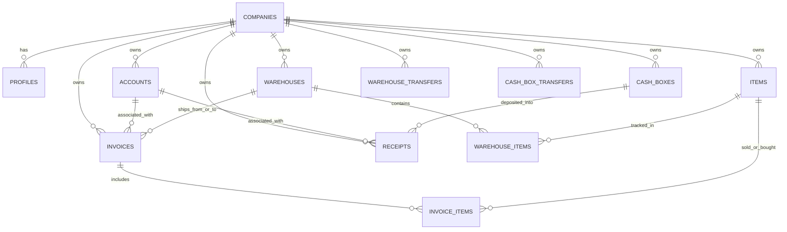

# 2. خريطة قاعدة البيانات (Database Architecture & Schema)

قاعدة بيانات مكسب بلس مبنية بالكامل على **PostgreSQL** عبر منصة **Supabase**. جميع الجداول تتبع مبدأ العزل الصارم للمستأجرين وتستخدم دقة `numeric(18,4)` للأموال والكميات.

---

## المخطط الهيكلي للجداول الرئيسية (Entity-Relationship)

---

## الجداول الأساسية (Core Tables)

### 1. الكيانات والشركات (Tenants & Identity)
- `companies`: بيانات الشركة الأساسية (الاسم، تاريخ الإنشاء).
- `profiles`: ملفات المستخدمين المرتبطة بـ `auth.users`؛ تحتوي على `company_id` و `access_role` ('owner' أو 'employee') وحالة النشاط `is_active`.
- `user_permissions`: مصفوفة الصلاحيات التفصيلية لكل مستخدم لكل شاشة ونوع مستند.

### 2. البيانات الرئيسية (Master Data)
- `accounts`: العملاء والموردين.
  - `kind`: إما 'customer' أو 'supplier'.
  - `serial_number`: رقم تسلسلي تلقائي لكل نوع (`CUS-00001` للعملاء، `SUP-00001` للموردين).
  - `balance`: الرصيد الحالي التراكمي (محدث تلقائياً بواسطة المعاملات).
  - `opening_balance`: الرصيد الافتتاحي عند بدء العمل.
- `items`: الأصناف والمنتجات.
  - `code`: كود الصنف (الباركود أو الرمز اليدوي).
  - `serial_number`: التسلسلي الآلي (`ITM-00001`).
  - `sale_price` & `purchase_price`: الأسعار الافتراضية.
  - `cost_price`: تكلفة الوحدة المحسوبة تلقائياً بأسلوب المتوسط المرجح (Moving Average Cost).
  - `current_qty`: إجمالي الرصيد الحالي عبر كل المخازن.
- `warehouses`: المخازن (`is_primary` يحدد المخزن الرئيسي، تسلسلي `WH-00001`).
- `warehouse_items`: جدول الربط لتتبع كمية الصنف في كل مخزن على حدة (`current_qty`, `opening_qty`).
- `cash_boxes`: الخزن النقدية وحسابات الدفع (`is_primary` يحدد الخزنة الافتراضية، تسلسلي `CBX-00001`).

### 3. حركة المستندات التجارية (Invoices & Line Items)
- `invoices`: فواتير البضاعة وتتضمن 5 أنواع:
  - `sale`: فاتورة بيع.
  - `purchase`: فاتورة شراء.
  - `sale_return`: مرتجع بيع.
  - `purchase_return`: مرتجع شراء.
  - `waste`: إتلاف / هالك مخزني.
  - الحقول المالية: `subtotal`, `discount`, `total`, `paid`, `remaining`, `cost_total`, `profit_total`.
  - التسلسل: `number` رقم الفاتورة التسلسلي لكل شركة ونوع.
- `invoice_items`: بنود الفاتورة (`item_id`, `qty`, `unit_price`, `cost_price`, `total`).

### 4. حركات النقدية والتحويلات (Cash & Transfers)
- `receipts`: سندات القبض والصرف.
  - `direction`: إما 'in' (سند قبض / استلام نقدية) أو 'out' (سند صرف / دفع نقدية).
  - `is_free`: سند حر (مباشر على الحساب) أو مرتبط بفاتورة محددة (`invoice_id`).
  - `amount`: المبلغ المدفوع.
- `warehouse_transfers`: إذن تحويل مخزني بين مخزنين (`source_warehouse_id` إلى `destination_warehouse_id`).
- `warehouse_transfer_items`: أصناف وكميات التحويل المخزني.
- `cash_box_transfers`: تحويل نقدية بين خزنتين (`source_cash_box_id` إلى `destination_cash_box_id`).

### 5. الرقابة والمطابقة (Audit & Reconciliations)
- `balance_reconciliation_logs`: سجلات عمليات الفحص والمطابقة الآلية للأرصدة والمخزون، مع حفظ الفروقات المكتشفة وتفاصيل من قام بالفحص.

---

## العرض والواجهات البرمجية لقاعدة البيانات (Views & Procedures)

### الواجهات (Views) - تعمل بـ `security_invoker = true`
- `v_invoice_list`: استعلام مجمّع ومفهرس لعرض الفواتير بأسماء الحسابات والمخازن مع تطبيق حجب الأرباح لغير المديرين.
- `v_receipt_list`: استعلام فواتير وسندات النقدية مع أرقام الخزن وأسماء العملاء والموردين.
- `v_warehouse_transfer_list`: استعلام التحويلات المخزنية.
- `v_cash_box_transfer_list`: استعلام تحويلات الخزن.

### دوال الـ KPI والترقيم السحابي (Pagination & KPIs)
- `get_invoice_page_columns` & `get_invoice_kpis_columns`: جلب صفحات الفواتير والمؤشرات المالية في استعلام واحد مع فلاتر الأعمدة والتأمين ضد ثغرات الحقن (SQL Injection).
- `get_receipt_page_columns` & `get_receipt_kpis_columns`: جلب سندات القبض والصرف ومؤشراتها.
- `get_warehouse_transfer_page_columns` & `get_cash_box_transfer_page_columns`: جلب التحويلات.
- `get_account_statement` & `get_cash_box_statement` & `get_item_movement_statement`: استخراج كشوف الحساب وحركات الأصناف متضمنة الرصيد التراكمي المتحرك (Running Balance).

---

## ملخص الهجرات (Migrations 0001 - 0070)

1. **0001 - 0003**: تأسيس الجداول، دالة `current_company_id()`، وسياسات RLS، ودوال الإنشاء الأولى.
2. **0004 - 0013**: إضافة السندات (Receipts)، قيود التعديل، الحذف المرن (Soft Delete)، فواتير المرتجع (Returns)، والحسابات الثابتة.
3. **0014 - 0019**: حساب تكلفة المخزون بالمتوسط المرجح، الأرصدة الافتتاحية، وإشارات أرصدة الحسابات.
4. **0020 - 0026**: التعدد المخزني (Multi-location Warehouses)، التحويلات الداخلية، والملاحظات.
5. **0027 - 0029**: الأرقام التسلسلية الآلية للكيانات (`CUS-`, `SUP-`, `ITM-`, `WH-`, `CBX-`).
6. **0030 - 0034**: كشوف الحسابات التفصيلية (Account, Cash Box, Item Movement Statements).
7. **0035 - 0039**: نظام الصلاحيات المتقدم (Granular Permissions)، وحماية المخزون ودوال المطابقة.
8. **0040 - 0044**: تعيين كلمات المرور، قيود التحقق، والكميات العشرية (`numeric(18,4)`).
9. **0045 - 0054**: ترقيم السيرفر ومؤشرات الـ KPIs، الرصيد التراكمي، إجمالي الفواتير غير المعياري، حجب الأرباح، وسجل تدقيق المطابقة.
10. **0055 - 0063**: حدود أمان الكتابة لـ RPCs، صلاحيات الإجراءات، حماية التكاليف، البحث بالمنشئ، وفلاتر الأعمدة المتقدمة.
11. **0064 - 0070**: عزل المخازن للمستأجرين، استعلامات الترقيم الحديثة، قفل السندات الحرة، إحصائيات لوحة التحكم، ودعم المقاصة وحسابات التداول المتبادل (Cross-Trading Balances).
