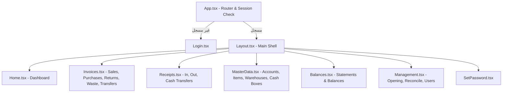

# 4. خريطة الفرونت إند وواجهة المستخدم (Frontend Architecture & UI/UX)

تم بناء الواجهة الأمامية لنظام **مكسب بلس** باستخدام **React 18** و **TypeScript** و **Vite** مع التزام صارم بقواعد الـ RTL، تجربة المستخدم للأنشطة التجارية السريعة، والتصميم الموحد للوثائق.

---

## بنية الصفحات والتوجيه (Routing & Pages)

### حماية المسارات (Route Guards)
- `AccessProvider`: يُغلف التطبيق بعد تسجيل الدخول ويقوم بجلب الصلاحيات التفصيلية للمستخدم وحفظها في السياق.
- `AccessRoute`: مكون حماية يمنع عرض أي صفحة إذا كان المستخدم لا يملك الصلاحية المطابقة، مع توجيهه إلى `/access-denied` في حال عدم وجود أي صلاحية نشطة.

---

## إدارة الحالة والبيانات المشتركة (State Management)

1. **`MasterDataContext` (`src/context/MasterDataContext.tsx`)**:
   - يوفر بيانات الكيانات الأساسية (العملاء، الموردين، الأصناف، المخازن، الخزن) المحدثة مع دوال التحديث الآني `refreshMasterData()`.
   - يتضمن ذاكرة مؤقتة تمنع الاستعلام المتكرر مع كل انتقال بين التبويبات.
2. **الحالة الموضعية (Local State)**:
   - تعتمد شاشات الفواتير والنماذج على الـ Hooks الموضعية (`useState`, `useEffect`, `useMemo`, `useCallback`) للحفاظ على سرعة الاستجابة اللحظية في المتصفح.

---

## نمط المستند الموحد (Unified Document Architecture)

تطبيقاً لقاعدة **Unified document layout** في `AGENTS.md`:
- `InvoiceForm.tsx`: هو المكون المركزي والوحيد المسؤول عن إنشاء، تعديل، وعرض جميع أنواع فواتير البضاعة (`sale`, `purchase`, `sale_return`, `purchase_return`, `waste`).
- `ReceiptForm.tsx`: المكون المركزي لسندات القبض والصرف.
- `WarehouseTransferForm.tsx`: المكون المركزي لأذون التحويل المخزني.
- `CashBoxTransferForm.tsx`: المكون المركزي لتحويلات الخزن.
- **وضع القراءة فقط (`isReadOnly`)**: يعرض نفس الحقول ونفس الجدول والترتيب بدون تشتيت لنمط المستخدم الذهني.

---

## المكونات المشتركة القياسية (Reusable Shared Components)

| المكون | المسار | الوظيفة |
| :--- | :--- | :--- |
| `DocumentListPage` | `src/components/DocumentListPage.tsx` | هيكل شاشة المستندات الموحد مع التبويبات وشريط الأدوات. |
| `DocumentTable` | `src/components/DocumentTable.tsx` | جدول عرض الوثائق الموحد مع الفرز والتمرير الأفقي والترقيم. |
| `ColumnFilterRow` | `src/components/ColumnFilterRow.tsx` | صف الفلاتر الديناميكية لكل عمود متصل بالباك إند. |
| `DateInput` / `TimeInput` | `src/components/DateInput.tsx` | إدخال التواريخ والأوقات بصيغة `DD/MM/YYYY` المتوافقة مع RTL. |
| `MoneyDisplay` | `src/components/MoneyDisplay.tsx` | عرض المبالغ المالية مع `dir="ltr"` وتنسيق الأرقام القياسي. |
| `SearchableSelect` | `src/components/SearchableSelect.tsx` | قائمة منسدلة سريعة تدعم البحث بلوحة المفاتيح والأسهم. |
| `StatusBadge` | `src/components/StatusBadge.tsx` | شارات الحالة (مسددة، جزئية، غير مسددة، نشط، موقوف). |
| `RowActions` | `src/components/RowActions.tsx` | قائمة إجراءات السطر (عرض، تعديل، حذف، استعادة، كشف حساب). |
| `ConfirmDialog` | `src/components/ConfirmDialog.tsx` | نافذة تأكيد الإجراءات الحساسة (مثل الحذف). |
| `KpiBar` | `src/components/KpiBar.tsx` | شريط المؤشرات المالية مع إخفاء الأرباح لغير المصرح لهم. |

---

## قواعد التصميم والـ RTL وتجربة المستخدم (UI/UX Guidelines)

1. **الأرقام والمبالغ**:
   - جميع الأرقام والتواريخ والأكواد محاطة بـ `dir="ltr"` و `tabular-nums` لمنع تداخل النصوص العربية مع الأرقام.
2. **خصائص CSS المنطقية (Logical Properties)**:
   - استخدام `margin-inline-start`, `padding-inline-end`, `text-align: start` حصرياً، وتجنب `left/right`.
3. **لغة وسياق الواجهة**:
   - لغة عربية مصرية بسيطة وسهلة للمستخدم العادي (مثل: "النهاردة", "امس", "عليه", "له", "خالص", "كاش", "آجل").
4. **التجاوب مع الشاشات (Responsiveness)**:
   - تصميم متجاوب يدعم شاشات سطح المكتب العريضة (1920px)، القياسية (1280px)، والشاشات اللوحية والمحمولة مع إخفاء الأعمدة الأقل أهمية أولاً في حال فتح اللوحة الجانبية للتفاصيل.
