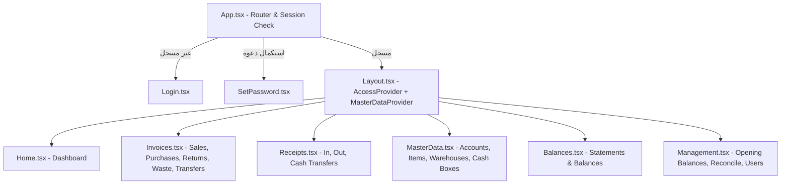

# 4. خريطة الفرونت إند وواجهة المستخدم (Frontend Architecture & UI/UX)

تم بناء الواجهة الأمامية لنظام **مكسب بلس** باستخدام **React 18** و **TypeScript** و **Vite** مع التزام صارم بقواعد الـ RTL، تجربة المستخدم للأنشطة التجارية السريعة، والتصميم الموحد للوثائق.

---

## بنية الصفحات والتوجيه (Routing & Pages)

### حماية المسارات (Route Guards)
- `AccessProvider` (`src/lib/access.tsx`): يُغلف التطبيق بعد تسجيل الدخول ويجلب الصلاحيات عبر `get_my_access` مع توفير خطاف `useAccess()` (`can()`, `canViewProfit`).
- `AccessRoute`: يتحقق من صلاحيات كل مسار (`/invoices`, `/receipts`, `/data`, `/balances`, `/management`) ويوجه غير المصرح لهم إلى `/access-denied`.

---

## إدارة الحالة والبيانات المشتركة (State Management)

1. **`MasterDataContext` (`src/context/MasterDataContext.tsx`)**:
   - يوفر بيانات الكيانات الأساسية النشطة (الحسابات، الأصناف، المخازن، الخزن) مع دوال التحديث الآني `refreshMasterData()`، ويحمي العرض عبر `MasterDataGate` عند اللزوم.
2. **الحالة الموضعية والخطافات المساعدة**:
   - خطافات مشتركة في `src/lib/` مثل `useColumnFilters`, `useCompleteStatement`, `useConfirmDialog`, `useDocumentPageNumber`, `useStableTableColumns`، ومنطق إدخال السطور في `docLineEntry.ts` وحسابات/تحقق الفواتير في `invoiceMath.ts` و`invoiceValidation.ts`.

---

## نمط المستند الموحد (Unified Document Architecture)

تطبيقاً لقاعدة **Unified document layout** في `AGENTS.md`:
- `InvoiceForm.tsx` مع مكوناته الفرعية في `src/components/invoice-form/` (`InvoiceAccountHeader`, `InvoiceItemsTable`, `InvoiceSummarySidebar`, والمغلف المشترك `DocumentSummarySidebar`): المكون المركزي والوحيد لإنشاء، تعديل، وعرض جميع أنواع الفواتير (`sale`, `purchase`, `sale_return`, `purchase_return`, `waste`).
- `ReceiptForm.tsx`: المكون المركزي لسندات القبض والصرف.
- `WarehouseTransferForm.tsx`: المكون المركزي لأذون التحويل المخزني، ويستخدم نفس التخطيط ثنائي الأعمدة ومغلف الشريط الجانبي المشترك `DocumentSummarySidebar`.
- `CashBoxTransferForm.tsx`: المكون المركزي لتحويلات الخزن.
- **وضع القراءة فقط (`readOnly`)**: يعرض نفس الحقول ونفس الجدول والترتيب عبر وضع القراءة دون تكرار نماذج منفصلة.

---

## المكونات المشتركة القياسية (Reusable Shared Components)

| المكون | المسار | الوظيفة |
| :--- | :--- | :--- |
| `DocumentListPage` / `DocumentListToolbar` | `src/components/` | هيكل شاشة المستندات الموحد مع التبويبات وشريط الأدوات والبحث والتصدير. |
| `DocumentTable` / `SortableHeader` / `Pagination` | `src/components/` | جدول عرض الوثائق الموحد مع الفرز والترقيم على السيرفر. |
| `ColumnFilterRow` | `src/components/ColumnFilterRow.tsx` | صف فلاتر الأعمدة الديناميكية المتصل بمخطط `listColumnSchema.json`. |
| `DateInput` / `TimeInput` | `src/components/DateInput.tsx`, `TimeInput.tsx` | إدخال التواريخ بصيغة `DD/MM/YYYY` والأوقات المتوافقة مع RTL. |
| `DateDisplay` | `src/components/DateDisplay.tsx` | عرض التواريخ والأوقات بتوقيت `Africa/Cairo` وصيغة `DD/MM/YYYY` في `<bdi dir="ltr">`. |
| `MoneyDisplay` | `src/components/MoneyDisplay.tsx` | عرض المبالغ المالية مع `dir="ltr"` و`tabular-nums`. |
| `AccountBalancePills` | `src/components/AccountBalancePills.tsx` | شارات عرض رصيد العميل/المورد قبل وبعد المستند. |
| `SearchableSelect` / `PickerInput` | `src/components/SearchableSelect.tsx`, `PickerInput.tsx` | قوائم اختيار وبحث سريعة بلوحة المفاتيح والباركود. |
| `StatusBadge` | `src/components/StatusBadge.tsx` | شارات الحالة (مسددة، جزئية، غير مسددة، نشط، موقوف، إلخ). |
| `RowActions` / `DocumentCreatorCell` | `src/components/RowActions.tsx`, `DocumentCreatorCell.tsx` | قائمة إجراءات السطر وخلية منشئ المستند. |
| `ConfirmDialog` / `Modal` / `ChangePasswordModal` | `src/components/` | النوافذ الحوارية وتأكيد الحذف بالاسم/الرقم وتغيير كلمة المرور. |
| `KpiBar` / `LoadingSkeleton` / `EmptyState` / `Toast` | `src/components/` | شريط المؤشرات، حالات التحميل والفراغ، والتنبيهات. |
| `DashboardChartsSection` | `src/components/charts/` | رسوم لوحة التحكم التفاعلية (`Chart.js`: `SalesTrendChart`, `SalesVsPurchasesChart`, `SalesDistributionChart`, `SparklineSvg`, `ChartContainer`, `ChartErrorBoundary`). |

---

## قواعد التصميم والـ RTL وتجربة المستخدم (UI/UX Guidelines)

1. **الأرقام والمبالغ والوحدات**:
   - جميع الأرقام والمبالغ والأكواد والتواريخ محاطة بـ `<bdi dir="ltr" className="tabular-nums">` لمنع تداخل النصوص العربية مع الأرقام في RTL.
   - الوحدات (`ج.م`, `قطعة`, `كجم`, ...) توضع كلواحق ثابتة خارج قيمة حقل الإدخال، ولا تُستخدم كـ placeholder.
   - حقول الأرقام تخفي الأسهم الافتراضية وتستخدم `inputMode="decimal"` وتُحدد القيمة تلقائياً عند التركيز (`select()`).
2. **محاذاة وخصائص CSS المنطقية**:
   - استخدام `margin-inline-start`, `padding-inline-end`, `text-align: start` حصرياً عبر `src/styles/`، وتجنب `left/right` في التخطيطات.
3. **إخفاء الأعمدة ذات الأولوية الأقل وتصدير Excel**:
   - عند فتح لوحة التفاصيل الجانبية، تُخفى الأعمدة الثانوية وتبقى الأعمدة الأساسية (الرقم، الحساب، الإجمالي، المتبقي) ظاهرة.
   - دعم تصدير المستندات والبيانات إلى Excel عبر `src/lib/documentExcel.ts` و`src/lib/exportRows.ts`.
4. **لغة وسياق الواجهة**:
   - لغة عربية مصرية بسيطة وواضحة للمستخدم العادي (مثل: "النهارده"، "أمس"، "عليه"، "له"، "خالص"، "كاش"، "آجل").
5. **التجاوب مع الشاشات (Responsiveness)**:
   - تصميم متجاوب يدعم شاشات سطح المكتب العريضة (`1920px`) والقياسية (`1280px`) والشاشات اللوحية والمحمولة.
