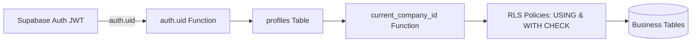

# 5. الأمان، الصلاحيات، وعزل المستأجرين (Security & Tenant Isolation)

الأمان وعزل المستأجرين في **مكسب بلس** يُمثل الأولوية القصوى؛ حيث تم تطبيق سياسات الدفاع في العمق (Defense in Depth) على مستوى قاعدة البيانات وقنوات الاتصال وواجهة المستخدم.

---

## عزل المستأجرين الصارم (Multi-Tenancy Isolation)



1. **دالة استخراج الشركة المركزية (`current_company_id()`)**:
   - تأخذ معرف المستخدم الحالي حصرياً من جلسة المصادقة الموثوقة `auth.uid()`.
   - تسترجع `company_id` من جدول `profiles`.
   - **لا يُسمح إطلاقاً** للواجهة الأمامية بتمرير `company_id` أو تحديده في أي استعلام أو دالة.
2. **سياسات أمان مستوى الصفوف (Row Level Security - RLS)**:
   - كل جدول عمل في النظام مفعل عليه RLS إجبارياً.
   - شرط القراءة: `USING (company_id = current_company_id())`.
   - شرط الكتابة: `WITH CHECK (company_id = current_company_id())`.
   - تم إثبات العزل عبر اختبارات SQL في `supabase/tests/` تضمن استحالة قراءة أو تعديل مستخدم شركة "ب" لبيانات شركة "أ".

---

## الأدوار ومصفوفة الصلاحيات التفصيلية (Roles & Permissions)

### 1. الأدوار الأساسية (`access_role`)
- **المدير (`owner`)**:
  - يملك كافة الصلاحيات حكماً (Bypasses permission checks inside PL/pgSQL helpers via `is_company_owner()`).
  - هو الوحيد القادر على إدارة المستخدمين وتعديل صلاحياتهم والوصول لصفحة المطابقات وسجلات التدقيق.
- **الموظف (`employee`)**:
  - يتم تحديد صلاحياته بدقة فائقة من خلال مصفوفة الصلاحيات في جدول `user_permissions`.

### 2. نطاقات مصفوفة الصلاحيات (Permission Scopes)
- **البضاعة والمستندات (`goods.*`)**:
  - `goods.sale.view`, `goods.sale.create`, `goods.sale.edit`, `goods.sale.delete`
  - `goods.purchase.*`, `goods.sale_return.*`, `goods.purchase_return.*`, `goods.waste.*`, `goods.warehouse_transfer.*`
- **المالية والنقدية (`money.*`)**:
  - `money.in.*` (سندات القبض), `money.out.*` (سندات الصرف), `money.cash_box_transfer.*` (تحويلات الخزن)
- **البيانات الرئيسية (`data.*`)**:
  - `data.customers.*`, `data.suppliers.*`, `data.items.*`, `data.warehouses.*`, `data.cashBoxes.*`
- **الأرصدة والتقارير (`balances.*`)**:
  - `balances.customers.view`, `balances.suppliers.view`, `balances.items.view`, `balances.cashBoxes.view`
- **الإدارة (`management.*`)**:
  - `management.opening.view`, `management.opening.edit`, `management.users.view`, `management.users.edit`
- **البيانات الحساسة والأرباح (`profit.view`)**:
  - رؤية أسعار التكلفة وهوامش الربح.

---

## حماية البيانات الحساسة (Profit & Cost Protection)

- **الحماية في قاعدة البيانات (وليس الواجهة فقط)**:
  - دالة `can_view_profit()` في PostgreSQL تتحقق مما إذا كان المستدعي هو صاحب الشركة أو يحمل صلاحية `profit.view`.
  - في حال عدم توفر الصلاحية: تعيد دوال العرض والـ RPCs (`v_invoice_list`, `get_invoice_kpis`, `get_warehouse_transfer_kpis`) قيمة `NULL` لحقول `profit_total` و `cost_total` و `cost_price`.
  - يمنع ذلك أي موظف من استخراج أرباح وتكاليف الشركة حتى لو حاول قراءة استجابات الشبكة (Network Payload).

---

## تحصين دوال قاعدة البيانات (SECURITY DEFINER Hardening)

تتبع جميع الدوال ذات الصلاحيات العالية القواعد الصارمة التالية:
1. **تحديد مسار البحث إجبارياً**: `SET search_path = public` لمنع هجمات التسميم التكتيكي لمسار البحث (Search Path Poisoning).
2. **التحقق من هوية المستدعي**:
   ```sql
   if v_company_id is null then
     raise exception 'not_authenticated' using errcode = '28000';
   end if;
   ```
3. **تقييد صلاحيات التنفيذ**:
   - `REVOKE ALL ON FUNCTION ... FROM public, anon;`
   - يتم المنح حصرياً للدور المعتمد: `GRANT EXECUTE ON FUNCTION ... TO authenticated;`.

---

## تأمين الاستعلامات وفلاتر الأعمدة (Query & Filter Sanitization)

1. **التعقيم ضد حقن النصوص (Escaping Pattern)**:
   - دالة البحث النصي تعقم الرموز الخاصة (`\`, `%`, `_`) قبل تمريرها لأوامر `ILIKE`:
     ```sql
     v_pattern := '%' || replace(replace(replace(v_search, chr(92), chr(92)||chr(92)), '%', chr(92)||'%'), '_', chr(92)||'_') || '%';
     ```
2. **التحقق من فلاتر الأعمدة (`validate_list_columns`)**:
   - يتم التحقق من كل عمود يُرسل للفلترة ضد مخطط معتمد مسبقاً (`list_column_schema`).
   - في حال إرسال اسم عمود غير مدرج أو محاولة تمرير أكواد SQL خبيثة يتم رفض الطلب فوراً بخطأ `invalid_filter_column`.
