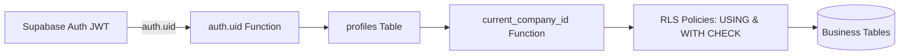

# 5. الأمان، الصلاحيات، وعزل المستأجرين (Security & Tenant Isolation)

الأمان وعزل المستأجرين في **مكسب بلس** يُمثل الأولوية القصوى؛ حيث تم تطبيق سياسات الدفاع في العمق (Defense in Depth) على مستوى قاعدة البيانات وEdge Functions وواجهة المستخدم.

---

## عزل المستأجرين الصارم (Multi-Tenancy Isolation)



1. **دالة استخراج الشركة المركزية (`current_company_id()`)**:
   - تأخذ معرف المستخدم الحالي حصرياً من جلسة المصادقة الموثوقة `auth.uid()` بشرط `is_active = true`.
   - تسترجع `company_id` من جدول `profiles`.
   - **لا يُسمح إطلاقاً** للواجهة الأمامية بتمرير `company_id` أو الاعتماد عليه؛ كل دالة `SECURITY DEFINER` تستنتجه داخلياً.
2. **سياسات أمان مستوى الصفوف (Row Level Security - RLS)**:
   - كل جدول عمل في النظام مفعل عليه RLS إجبارياً.
   - شرط القراءة: `USING (company_id = current_company_id())`.
   - شرط الكتابة: `WITH CHECK (company_id = current_company_id())`.
   - تم إثبات العزل عبر اختبارات SQL في `supabase/tests/` (مثل `002_rls_isolation.sql` و`052_warehouse_item_tenant_isolation.sql` و`065_permissions_security_and_lock_order.sql` حتى `069_cross_trading_returns_and_decimal_edges.sql`) تضمن استحالة قراءة أو تعديل مستخدم شركة أخرى أو الدور `anon` لبيانات الشركة.

---

## الأدوار ومصفوفة الصلاحيات التفصيلية (Roles & Permissions)

### 1. الأدوار الأساسية (`access_role`)
- **المدير (`owner`)**:
  - يملك كافة الصلاحيات حكماً عبر `is_company_owner()`.
  - هو الوحيد المخول بدعوة الموظفين، وتعديل صلاحياتهم (`set_user_permissions`)، وتغيير كلمات مرورهم (عبر `manage-users` Edge Function و`set_company_user_password`)، وتشغيل المطابقات (`run_comprehensive_reconciliation`, `reconcile_item_stock`) وقراءة `balance_reconciliation_logs`.
- **الموظف (`employee`)**:
  - تُحدد صلاحياته بدقة من خلال مصفوفة الصلاحيات في جدول `user_permissions`، وتتحقق منها دالة `has_permission(p_key)` (التي تدعم التطبيع بين `cashBoxes` و`cash_boxes` منذ الهجرة `0080` ومفاتيح القسم الشاملة أو `*`).

### 2. نطاقات مصفوفة الصلاحيات (`src/lib/permissionsConfig.ts`)
- **قسم البضاعة (`goods.*`)** (بإجراءات `view`, `create`, `edit`, `delete`):
  - `goods.sale.*`, `goods.purchase.*`, `goods.sale_return.*`, `goods.purchase_return.*`, `goods.waste.*`, `goods.warehouse_transfer.*`
- **قسم الفلوس (`money.*`)** (بإجراءات `view`, `create`, `edit`, `delete`):
  - `money.in.*`, `money.out.*`, `money.cash_box_transfer.*`
- **قسم الأرصدة والتقارير (`balances.*`)** (بإجراء `view`):
  - `balances.customers.view`, `balances.suppliers.view`, `balances.items.view`, `balances.cashBoxes.view`
- **قسم البيانات الأساسية (`data.*`)** (بإجراءات `view`, `create`, `edit`, `delete`):
  - `data.customers.*`, `data.suppliers.*`, `data.items.*`, `data.warehouses.*`, `data.cashBoxes.*`
- **قسم إدارة الأرصدة الافتتاحية (`management.*`)** (بإجراءي `view`, `edit`):
  - `management.customers.*`, `management.suppliers.*`, `management.items.*`, `management.cashBoxes.*`
- **قسم التقارير والربحية (`reports.*`)**:
  - `reports.profit.view`: رؤية أسعار التكلفة وهوامش الربح وتقييم المخزون بالتكلفة.

---

## حماية البيانات الحساسة (Profit, Cost & Purchase Price Protection)

- **حماية التكلفة والربح (`can_view_profit()`)**:
  - تتحقق الدالة في PostgreSQL من `is_company_owner() or has_permission('reports.profit.view')` (تم تثبيتها في الهجرة `0078`).
  - عند عدم توفر الصلاحية: تُرجع العروض ودوال الـ KPI (`v_invoice_list`, `v_invoice_items`, `v_warehouse_transfer_items`, `v_warehouse_items`, `v_stock_opening_balances`, `get_invoice_kpis_columns`, `get_warehouse_transfer_kpis_columns`, `get_warehouse_stock_kpis_columns`) قيمة `NULL` لحقول التكلفة والربح والتقييم، كما تُحجب القراءة المباشرة عبر `read_protected_cost` وتُمنع الفلترة على الأعمدة الحساسة (`ownerOnly` في `validate_list_columns`).
- **حماية سعر الشراء (`can_view_purchase_price()` و`read_protected_purchase_price()` - هجرتا `0080` و`0081`)**:
  - تتحقق من `can_view_profit()` أو امتلاك أي صلاحية شراء أو مرتجع شراء (`goods.purchase.*`, `goods.purchase_return.*`).
  - سُحبت القراءة المباشرة لعمود `items.purchase_price` عن دور `authenticated` لصالح دوال العرض والفلترة المحمية (`0081`)، وتُحجب قيمة `purchase_price` (`NULL`) في `v_warehouse_items`, `v_stock_opening_balances`, `v_item_stock` و`filter_master_item_rows` وتُمنع تصفيته عبر `validate_list_columns` للموظفين غير المخولين. كما تخفي الواجهة حقل تكلفة الوحدة الافتتاحية عند إنشاء الصنف لمن لا يملك `canViewProfit`.

---

## حدود الكتابة وفرض الصلاحيات في الـ RPCs

1. **إلغاء الكتابة المباشرة للمستندات والمخزون (`0055`–`0058`, `0080`)**:
   - تتم جميع عمليات إنشاء وتعديل وحذف واستعادة المستندات، وحركات المخزون، وإدارة البيانات الأساسية، والأرصدة الافتتاحية حصرياً عبر دوال RPC تتحقق من `require_permission(...)` و`guard_permission_write()`.
2. **تغطية الصلاحيات الدقيقة (`0080`)**:
   - تفرض الدوال في `0080` الصلاحيات الفرعية على دوال البيانات الأساسية (`create_warehouse`, `update_warehouse`, `delete_warehouse`, `create_cash_box_...`, `create_item_...`, `delete_item`, `save_account`, `delete_account`)، ودوال الافتتاحيات (`save_account_opening_balances`, `save_opening_balances`)، وكشوف الحسابات (`get_account_statement`, `get_cash_box_statement`, `get_item_movement_statement`).
3. **إدارة المستخدمين (`supabase/functions/manage-users`)**:
   - تتحقق الدالة السحابية من JWT المستدعي واستدعاء `is_company_owner()` قبل تنفيذ `list` أو `invite` أو تغيير كلمة المرور، وترفض أي طلب عند رفض دالة قاعدة البيانات دون تجاوز إداري.

---

## تحصين دوال قاعدة البيانات (SECURITY DEFINER & Views)

1. **تحديد مسار البحث إجبارياً**: `SET search_path = public` (أو `public, pg_temp`) لمنع هجمات تسميم مسار البحث، بما في ذلك `cairo_today()` و`set_updated_at()`.
2. **التحقق من هوية المستدعي**:
   ```sql
   if v_company_id is null then
     raise exception 'not_authenticated' using errcode = '28000';
   end if;
   ```
3. **تقييد صلاحيات التنفيذ والعروض**:
   - `REVOKE ALL ON FUNCTION ... FROM public, anon;` مع منح `authenticated` فقط للدوال المخصصة للاستدعاء من العميل.
   - سحب استدعاء الدوال المساعدة الداخلية (`next_document_number`, `purchase_invoice_has_later_outflow`, `warehouse_transfer_has_later_movement`, `resolve_sale_return_unit_cost`, `recalc_invoice_totals`, `apply_stock_movement`, `calculate_expected_*`) من `authenticated` أيضاً (`0055`, `0080`, `0083`, `0084`).
   - تشغيل كافة العروض (`v_*`) بخاصية `security_invoker = true` وسحب صلاحيات `public, anon` عنها.

---

## تأمين الاستعلامات وفلاتر الأعمدة (Query & Filter Sanitization)

1. **التعقيم ضد حقن النصوص**: تعقم دوال البحث الرموز الخاصة (`\`, `%`, `_`) قبل استخدامها في `ILIKE`، وتستخدم الواجهة استعلامات RPC أو معاملات مهيكلة بدلاً من تمرير نصوص غير مهربة.
2. **التحقق من فلاتر الأعمدة (`validate_list_columns`)**: تتحقق من كل عمود ومُعامل فلترة ضد `list_column_schema` المعتمدة وترفض أي عمود غير مسموح به برمز خطأ `invalid_filter_column` أو `permission_denied`.
